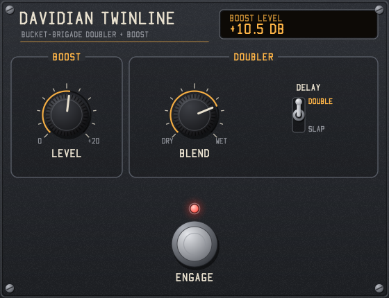

# Davidian Twinline

A circuit-modelled doubler pedal plugin (LV2, VST3 and Audio Unit), modelled on the circuit of a classic 1970s double-tracking pedal: a BS170 boost stage, then the dry signal and a V3205 bucket-brigade (BBD) delay mixed by a Blend pot, with a switch for a short doubling delay or a longer slapback.

**A close model, not an exact copy.** It is a simulation of the circuit from its component values, not a sampled or measured pedal, and some details are reasoned estimates (listed under [Estimates](#estimates)). It has not been compared side by side with a built unit, so expect it to sound close to the hardware rather than identical.



Mono in and out in LV2, like the pedal; the VST3 and Audio Unit versions also run mono or stereo (1 in/1 out, 1 in/2 out or 2 in/2 out), as two copies of the pedal with the same settings. No latency on the dry path. The same GUI in every format, except the Linux VST3, where the host shows its own controls. GPL-3.0-or-later.

| Format | Windows | macOS | Linux |
|---|---|---|---|
| LV2 | yes | yes | yes |
| VST3 | yes | yes | yes (no GUI) |
| Audio Unit (AUv2) | | yes | |

## Download

Ready-made builds are on the [Releases page](https://github.com/evadavevadave/davidian-twinline/releases):

| Download | Contains | For |
|---|---|---|
| `…-windows-x64.zip` | LV2, VST3 | Windows 10/11, 64-bit hosts |
| `…-macos-universal.zip` | LV2, VST3, Audio Unit | macOS 10.13 or later, Apple silicon and Intel |
| `…-linux-x64.zip` | LV2, VST3 | 64-bit Intel/AMD Linux (glibc 2.35 or later) |
| `…-linux-arm64.zip` | LV2, VST3 | 64-bit ARM Linux, e.g. Raspberry Pi 4/5 (glibc 2.35 or later) |

Unzip, copy the plugin folder for your host's format into its plugin folder, and restart your host (or rescan plugins):

| Format | Copy | Into |
|---|---|---|
| VST3 (Windows) | `twinline.vst3` | `%COMMONPROGRAMFILES%\VST3` |
| VST3 (macOS) | `twinline.vst3` | `~/Library/Audio/Plug-Ins/VST3` |
| VST3 (Linux) | `twinline.vst3` | `~/.vst3` |
| Audio Unit (macOS) | `twinline.component` | `~/Library/Audio/Plug-Ins/Components` |
| LV2 (Windows) | `twinline.lv2` | `%APPDATA%\LV2` (create it if it doesn't exist) |
| LV2 (macOS) | `twinline.lv2` | `~/Library/Audio/Plug-Ins/LV2` |
| LV2 (Linux) | `twinline.lv2` | `~/.lv2` |

In the host it is listed as **Davidian Twinline** (VST3, LV2) or under **Davidian** as **Twinline** (Audio Unit; Logic shows **Davidian: Twinline**). Replace any older copy instead of keeping two. The LV2 URI is `urn:davidian:twinline` and the Audio Unit is `aufx Twln Dvdn`.

The macOS build isn't notarized, so macOS may block it after download. Run these once in Terminal after copying, for each format you installed:

```bash
xattr -dr com.apple.quarantine ~/Library/Audio/Plug-Ins/Components/twinline.component
```

```bash
xattr -dr com.apple.quarantine ~/Library/Audio/Plug-Ins/VST3/twinline.vst3
```

```bash
xattr -dr com.apple.quarantine ~/Library/Audio/Plug-Ins/LV2/twinline.lv2
```

Logic Pro and GarageBand only show an Audio Unit once macOS has registered it. If it doesn't appear, log out and back in, or restart the Mac.

## Controls

| Panel | Control | Circuit part |
|---|---|---|
| Boost | Level | C5K pot in the BS170 boost stage: 0 to +20 dB, default 0 dB |
| Doubler | Blend | A10K pot, dry to wet, default 0.75. Audio taper, about 10% wet at noon |
| Doubler | Delay: Double / Slap | SPST switch on the CD4047 clock, default Double |
| Footswitch | Engage | The pedal's bypass switch; its red LED shows the state. Off passes the input through untouched |
| (host) | Enabled / Bypass | Plugin bypass, so the host's bypass button works: `lv2:enabled` in LV2, the bypass parameter in VST3, and the bypass property (plus an Enabled parameter) in the Audio Unit. The panel has no control for it |

Both bypasses fade over about 10 ms. The circuit keeps running while bypassed, so switching back in doesn't click. Flipping the Delay switch while a note is sounding bends its pitch, as changing the clock does on the real pedal.

In VST3 and AU every control is a parameter the host can automate, with the same numbers as the LV2 ports, and the GUI follows automation as it plays. The readout shows the name and value of the last control you touched.

Drag a knob up or down, hold Shift to fine-tune, use the mouse wheel, and double-click to reset. Click the upper or lower half of the Delay switch to pick Double or Slap. Dragging a knob is recorded as one gesture.

## How it is modelled

All in `src/dsp.h`, with the layout's part values.

- **Boost:** the input is scaled by Level, then soft-limited with a slight asymmetry for the MOSFET stage. A 5 Hz high-pass removes the resulting DC.
- **Wet path:** a 100 Hz high-pass, then oversampling for the BBD section: 4x at 44.1/48 kHz, 2x at 88.2/96 kHz, none at 176.4 kHz and up.
- **Pre-filter:** a 7 kHz two-pole low-pass.
- **BBD:** a 2048-cell buffer clocked at the CD4047 rate, not the host's sample rate. Samples are taken and held at the clock edges, so the delay time, the aliasing and the clock images all follow the real clock. A soft limit before the BBD stands in for its limited voltage swing.
- **Post-filter:** a Sallen-Key low-pass (7 kHz, Q 0.73) and a 4.8 kHz one-pole, then a Butterworth filter back down to the host rate.
- **Mix:** dry and wet are mixed by the Blend taper, then crossfaded with the clean input for bypass.

### Checked against the layout

Values read from the layout:

| Item | Value | From |
|---|---|---|
| Clock, Slap | 22.7 kHz → 90.1 ms | CD4047, f = 1/(4.4 RC), R = 100K, C = 100p |
| Clock, Double | 65.0 kHz → 31.5 ms | 47K + 6K8 switched in parallel with the 100K |
| BBD length | 4096 stages = 2048 clock periods | V3205 |
| Post-filter | 7.0 kHz, Q 0.73 | Sallen-Key, 33K/33K with 1n/470p |
| Output RC | 4.8 kHz | 33K and 1n |
| Pre-filter | 7.2 kHz | 4K7 and 4n7 (taken as a matching 7 kHz stage) |

Measured from the built plugin by `test_host`, the onset of a burst arrives after 32.8 ms (Double) and 91.4 ms (Slap). That includes the filters' group delay. The wet signal is about 0.2 dB down at 1 kHz, 5 dB down at 5 kHz and 11–12 dB down at 7 kHz. With a 5 kHz tone on Slap, the BBD clock image is about 36 dB below the tone.

### Estimates

The layout doesn't show these, so they are reasoned estimates:

- **Boost range and clipping:** 0 to +20 dB, with the boost limiting around +8 dBFS. This assumes 0 dBFS = 1 V. Constants are at the top of `src/dsp.h`.
- **BBD headroom:** a soft limit at about 1.2 V.
- **Wet high-pass:** 100 Hz.
- **Blend direction:** clockwise is assumed to be more wet.
- **The clock reading itself:** the timing parts were traced from a small image, so the two delay times could be off if the switch wiring differs from how it was traced.

### Simplifications

- No BBD hiss or bias trimmer (TR1). The V3205 here has no compander, so the real pedal is noisier than the model.
- The op amp filters are ideal, apart from the soft limits above.
- The LED indicator isn't modelled. The GUI's footswitch LED shows the bypass state instead.

## Build

The code is plain C (Objective-C for the macOS GUI and Audio Unit) with no dependencies beyond the platform's own libraries: Win32 on Windows, Cocoa and AudioToolbox on macOS, Xlib on Linux and BSD. No LV2, VST3 or AU SDK is needed: the LV2 interface is declared in the source, and the VST3 version uses Steinberg's one-file C API header, included in `src/vst3/`.

| Source | What it is |
|---|---|
| `src/dsp.h` | The circuit model (the mono pedal), shared by every format |
| `src/engine.h` | One or two copies of the pedal for the VST3 and AU versions (mono or stereo) |
| `src/ports.h`, `src/params.h` | Port numbers, also the VST3/AU parameter IDs, and the parameter names, ranges, defaults and switch positions |
| `src/twinline.c`, `src/ui/ui_lv2.c` | LV2 plugin and GUI |
| `src/vst3/vst3.c` | VST3 plugin in C: processor, controller, state and editor in one object |
| `src/au/au.m` | Audio Unit, with its Cocoa view |
| `src/ui/panel.h`, `src/ui/window.h` | The panel and the window layer under it (Win32, X11, Cocoa), shared by every GUI |
| `src/ui/style.h`, `canvas.h`, `font.h` | Davidian GUI house style: palette, renderer and stroke font |
| `src/lv2_abi.h` | The LV2 C interface, so no SDK is needed |
| `bundle/` | LV2 metadata (`manifest.ttl.in` gets each platform's library names and GUI type at build time), and the macOS property lists for the VST3 and AU bundles |

The VST3 and AU wrappers follow the ones in Davidian Seventy-Three, adapted to this pedal.

### Windows (Visual Studio)

Needs Visual Studio with the C++ tools. `build.bat` finds them on its own, and builds `build\lv2\twinline.lv2` and `build\vst3\twinline.vst3`. `build.bat dist` zips them with the docs.

```bash
build.bat
```

### macOS, Linux, BSD, MinGW

Needs a C compiler and `make`. On Linux, also the X11 headers (`build-essential libx11-dev` on Debian/Ubuntu). On macOS, the Xcode command-line tools; the build is universal (Apple silicon and Intel) and also makes the Audio Unit, `build/au/twinline.component`.

```bash
make
```

```bash
make install
```

`make install` copies the bundles to your per-user plugin folders. `make dist VERSION=x.y.z` zips them with the docs.

## Tests

Windows:

```bash
build.bat test
```

macOS, Linux:

```bash
make test
```

- `test_host` loads the built LV2 plugin library directly and checks delay times, frequency response, BBD clock images, Blend and Level, block-size independence, overload and CPU use (about 0.5% of one core at 48 kHz). It runs on every platform. The VST3 and AU versions run the same DSP code.
- `ui_render` draws the panel to a BMP file without opening a window.
- `ui_check` (Windows) and `ui_check_mac` (macOS) host the LV2 GUI in a window and drive it with mouse input. `ui_load_check` (Linux) opens the X11 GUI and runs its idle loop, usually on a virtual display with `xvfb-run`.
- `lilv_check` (Windows) validates the bundle with the LV2 parser from an Ardour 9 install. On Linux, CI does the same check with `lv2info` and `lv2apply`.
- `vst3_check` loads the VST3 the way a host does and checks its factory, buses, parameters, audio, bypass and saved state, on every platform. On Windows it also opens the editor, drives it with the mouse and checks that every edit reaches the host inside a gesture.
- `au_check_mac` (macOS) opens the installed Audio Unit, renders audio, checks bypass and saved state, and drives its Cocoa view.

CI also runs Steinberg's VST3 validator and Apple's `auval` on the builds.

GitHub Actions builds every format on Windows, macOS, Linux x64 and Linux arm64 for every push (see `.github/workflows/build.yml`). Pushing a `v*` tag publishes a release with a zip for each platform.

## Use of AI

Made with generative AI (Claude Code, Anthropic's Claude Opus 5.5), directed and reviewed by Davidian. The code, tests, plugin metadata, build scripts and this README were written by the AI.

- **The author** supplied the circuit layout, the GUI house style, the names and the licensing choices. They also decided what to build and changed parts of the result themselves.
- **The AI** read component values off the layout image and worked out the clock rates and filter corners. It also wrote the DSP model, adapted the GUI to this panel, adapted the VST3 and Audio Unit wrappers and the cross-platform builds, and wrote the test programs and documentation.
- **Checking:** the results are checked by the automated tests described above (delay times, frequency response, the lilv LV2 parser, the GUIs driven by simulated mouse input, the VST3 and AU test hosts) and by Steinberg's VST3 validator and Apple's auval. The values listed under [Estimates](#estimates) are the AI's estimates and haven't been checked against a real pedal.

## References

- Circuit: a stripboard layout of the original pedal (tagboardeffects), kept for reference in `doubler_layout.png`.
- CD4047 astable frequency, f = 1/(4.4 RC): the CD4047B datasheet.
- Sallen-Key and Butterworth low-pass filters: standard filter design (e.g. Williams and Taylor, *Electronic Filter Design Handbook*).

## Licence

Copyright (C) 2026 Davidian. GPL-3.0-or-later: you can redistribute it and/or modify it under the terms of the GNU General Public License as published by the Free Software Foundation, either version 3 of the License, or (at your option) any later version. It is distributed in the hope that it will be useful, but WITHOUT ANY WARRANTY; without even the implied warranty of MERCHANTABILITY or FITNESS FOR A PARTICULAR PURPOSE. See [LICENSE](LICENSE) for the full text. Every source file starts with an SPDX licence line saying which licence applies to it.

### Third-party licences

| Component | Licence | How it's used |
|---|---|---|
| LV2 C interface (`lv2/core/lv2.h`, `lv2/ui/ui.h`) | ISC | Its declarations are re-stated in `src/lv2_abi.h`, the UI ABI block of `src/ui/ui_lv2.c` and five test programs, so no LV2 SDK is needed. Copyright and permission notice in [LICENSE-LV2](LICENSE-LV2). |
| LV2 vocabularies (`lv2core`, `ui`, `units`) | ISC | The `.ttl` files refer to them by URI. Nothing is copied. |
| lilv | ISC | `tests/lilv_check.c` loads the copy that ships with Ardour 9 at run time. Not included in this repository. |
| Ardour 9 | GPL-2.0-or-later | Used only as a test host and as the source of lilv for `lilv_check`. No Ardour code is included. |
| Microsoft C runtime | Visual Studio licence | `build.bat` links it statically (`/MT`) into the DLLs you build. It counts as a system library under the GPL, so this is allowed. No binaries are committed to this repository. |
| Xlib (Linux) | MIT/X11 | The Linux GUI links to the system's `libX11` at run time. Not included. |
| macOS frameworks (Cocoa, Core Graphics) | Apple SDK licence | The macOS GUI links to the system frameworks at run time. They are system libraries under the GPL. Not included. |
| VST3 C API header (`src/vst3/vst3_c_api.h`) | BSD 3-clause | Steinberg's machine-generated C version of the VST3 interfaces, from [vst3_c_api](https://github.com/steinbergmedia/vst3_c_api), included unchanged. It declares the interfaces and contains no SDK code. Copyright (c) 2025 Steinberg Media Technologies GmbH; licence in [src/vst3/LICENSE.txt](src/vst3/LICENSE.txt), shipped as `LICENSE-VST3.txt` in every release zip and inside the VST3 bundle. Compatible with the GPL. |
| Apple frameworks (AudioToolbox, AudioUnit, CoreAudio) | Apple SDK licence | The Audio Unit links to them at run time. They are system libraries under the GPL. Not included. |
| Steinberg VST3 validator, Apple auval | MIT, Apple | Used in CI to check the builds. Nothing from them ends up in the binaries. |
| GitHub Actions | GitHub terms | Builds the release zips. Nothing from it ends up in the binaries. |

VST is a registered trademark of Steinberg Media Technologies GmbH. Audio Units is a trademark of Apple Inc. They are named here only to say which plugin formats this project supports.
